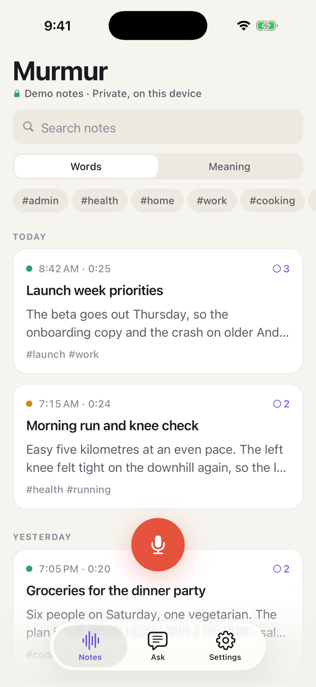
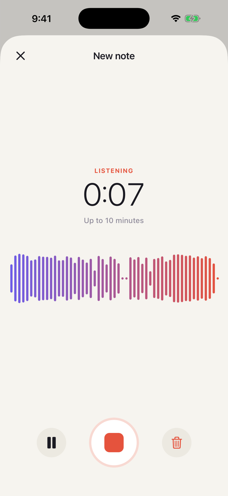
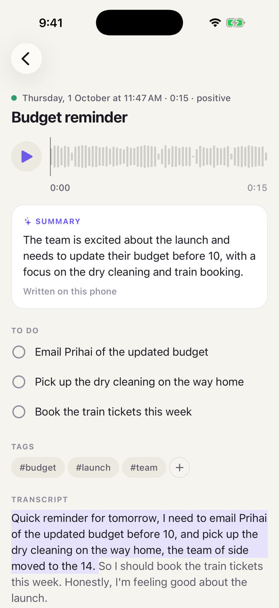
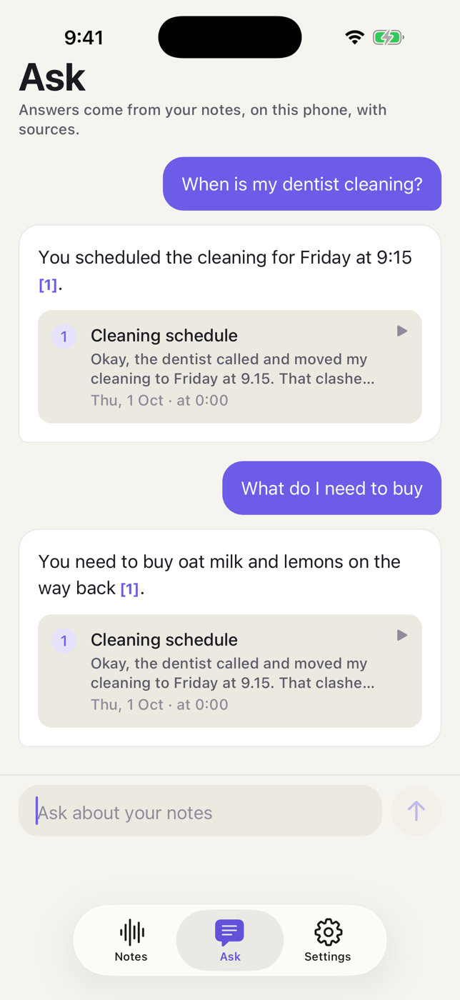
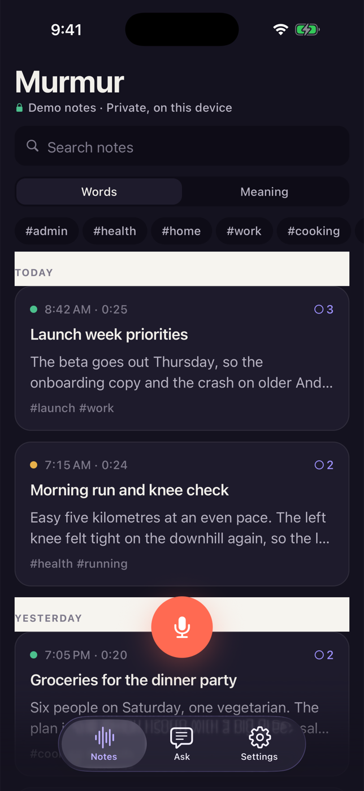
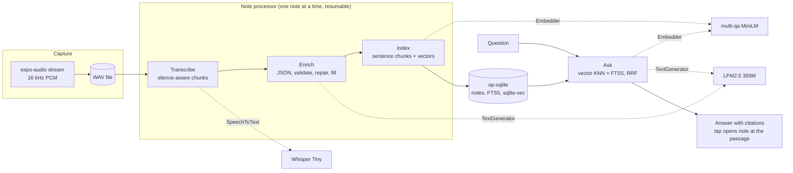

# Murmur

A private voice journal for iOS and Android where nothing leaves the phone. Speak, and on-device Whisper transcribes; an on-device language model writes a title, summary, tags and to-dos; and **Ask your notes** answers questions across every note, with citations, using on-device embeddings.

[](https://github.com/OwaisMunawar/murmur/actions/workflows/ci.yml)
[](https://docs.expo.dev/versions/v57.0.0/)
[](LICENSE)


<p align="center">
  
  
  
  
  
</p>

<sub>Left to right: notes list (demo mode), recording, note detail and Ask (all three with the real on-device models), dark mode (demo mode). Every screenshot is from the iOS simulator; the full set and how each was made is in [Screenshots](#screenshots).</sub>

## Why

Voice notes are the most private thing on a phone: half-formed plans, health worries, names. Sending them to a server to get a summary is the wrong trade. Small speech and language models now run well on phones, so Murmur does the whole job locally: recording, transcription, summaries, search and question answering. The only network traffic is downloading the models, once, when you ask for them.

## Features

- **Record.** A big record button, a live Skia waveform drawn on the UI thread, pause and resume, and a 10-minute guard that saves what you have when you reach it. Audio is captured as 16 kHz PCM and stored as WAV on the device.
- **Transcribe on device.** Whisper Tiny (multilingual) through ExecuTorch. Audio is split at natural pauses into chunks, so progress is real, silence never reaches the model (Whisper invents "Thank you." on silence), and every sentence keeps an approximate timestamp. Whisper on ExecuTorch has no language detection, so Murmur uses your device language unless you pick one.
- **Enrich.** LFM2.5 350M writes a title, a 2–3 sentence summary, tags, to-dos and a mood as JSON. Each field is validated with zod; missing or broken fields are asked for again (once), and anything still missing comes from a heuristic, field by field. The note says which happened.
- **Ask your notes.** Notes are chunked and embedded with multi-qa MiniLM into sqlite-vec. A question retrieves the nearest passages, fuses them with full-text matches, and the local model answers with numbered citations. Tap a citation to open the note at that moment.
- **Notes list.** Grouped by day, full-text search (FTS5) or search by meaning (embeddings), tag filters, swipe to delete with undo.
- **Note detail.** Playback scrubber with a drag-to-seek waveform, a transcript you can tap to seek, editable title and tags, to-dos as checkboxes, and a "rewrite with the language model" action for notes made before it was installed.
- **Model manager.** Download, cancel and delete each model, with progress, size on disk and licence. Wi-Fi only by default. The app works before any model is installed and says exactly what each one switches on.
- **Privacy by design.** One module can touch the network. A lint rule and a unit test fail the build if that changes, and the Privacy screen lists every request the app can make.
- **Demo mode.** `EXPO_PUBLIC_DEMO=1` seeds 12 fictional notes and swaps every engine for a deterministic fake behind the same interfaces, for CI, tests and first-run screenshots.

## Architecture



- **Engines behind interfaces.** `SpeechToText`, `TextGenerator` and `Embedder` each have an ExecuTorch implementation and a deterministic fake. A small composition root ([`src/composition`](src/composition)) picks one set and hands it to the screens through context; domain code never reaches for a singleton.
- **Feature-first layout.** `src/features/{recording,transcription,enrichment,ask,notes,models,settings}`, each with `lib/` (pure, tested logic), `data/` (repositories), `engine/` (interfaces and implementations), `pipeline/` (orchestration), `components/` and `screens/`. Routes in `src/app` are one-line re-exports.
- **Resumable pipeline.** Every stage persists its output and status before the next starts, so a killed app resumes from the last finished stage. A model finishing its download resumes the notes that were waiting for it.
- **Off the JS thread.** ExecuTorch runs inference on its own worklet runtime; op-sqlite runs every query on a native thread, and vector KNN runs inside SQLite; the waveform path is rebuilt in a worklet and drawn by Skia.

The decisions behind all of this, with the alternatives that were rejected, are in [docs/ARCHITECTURE.md](docs/ARCHITECTURE.md).

## Tech stack

| Area         | Choice                                                                                                                                                   |
| ------------ | -------------------------------------------------------------------------------------------------------------------------------------------------------- |
| App          | Expo SDK 57 (React Native 0.86, React 19.2, New Architecture), Expo Router, React Compiler, development build                                            |
| On-device AI | `react-native-executorch` 0.10.4 (XNNPACK backend): Whisper Tiny, LFM2.5 350M, multi-qa MiniLM L6                                                        |
| Storage      | `@op-engineering/op-sqlite` 18.2 with FTS5 and sqlite-vec, versioned migrations                                                                          |
| Audio        | `expo-audio` (PCM capture stream, playback)                                                                                                              |
| UI           | `@shopify/react-native-skia` 2.13, Reanimated 4.5, `@legendapp/list` 3.6, `expo-symbols`, design tokens with light and dark themes                       |
| Validation   | zod 4, jsonrepair                                                                                                                                        |
| Quality      | TypeScript strict with `noUncheckedIndexedAccess`, ESLint (eslint-config-expo) and Prettier, Jest (jest-expo) with real SQLite, Testing Library, Maestro |

Reanimated is on 4.5 rather than 4.7 on purpose: 4.7 needs react-native-worklets 0.13, while SDK 57's expo-modules-core and ExecuTorch 0.10.4 both cap worklets below that (ADR-008).

## Quick start

Murmur uses native modules (ExecuTorch, op-sqlite, Skia), so it runs as a development build, not in Expo Go. You need Xcode 26 for iOS or Android Studio for Android.

```bash
npm install
npx expo run:ios                       # or: npx expo run:android
EXPO_PUBLIC_DEMO=1 npx expo run:ios    # optional: demo mode with fictional notes and fake engines
```

On first launch, open **Models** and download what you want (about 610 MB for all three). Until then you can record; notes are transcribed when the speech model arrives. In debug builds the record screen has a **Use sample clip** button that replays a bundled clip through the capture path, because the simulator's microphone cannot be scripted.

## Models

All three run on the CPU through ExecuTorch's XNNPACK backend, pinned explicitly so iOS devices, the iOS simulator and Android behave the same.

| Model                                                                                                                  | Used for                                 | Variant       | Download | Licence                                                                                                              |
| ---------------------------------------------------------------------------------------------------------------------- | ---------------------------------------- | ------------- | -------- | -------------------------------------------------------------------------------------------------------------------- |
| [Whisper Tiny](https://huggingface.co/software-mansion/react-native-executorch-whisper-tiny) (+ FSMN-VAD)              | Transcription, 99 languages              | XNNPACK FP32  | 237 MB   | Whisper: [MIT](https://github.com/openai/whisper/blob/main/LICENSE); FSMN-VAD and the ExecuTorch exports: Apache-2.0 |
| [LFM2.5 350M](https://huggingface.co/software-mansion/react-native-executorch-lfm-2.5)                                 | Titles, summaries, tags, to-dos, answers | XNNPACK 8da4w | 282 MB   | [LFM Open License v1.0](https://huggingface.co/LiquidAI/LFM2.5-350M/blob/main/LICENSE)                               |
| [multi-qa MiniLM L6 cos v1](https://huggingface.co/software-mansion/react-native-executorch-multi-qa-MiniLM-L6-cos-v1) | Embeddings for search and Ask            | XNNPACK FP32  | 91 MB    | [Apache-2.0](https://huggingface.co/sentence-transformers/multi-qa-MiniLM-L6-cos-v1)                                 |

Models are exported by [Software Mansion](https://huggingface.co/software-mansion) for ExecuTorch. Weights are downloaded at runtime and are never committed to this repository.

## Performance

Measured by the app itself (Settings shows the latest numbers) on the **iOS 26.5 simulator on an Apple M2 Mac**, Debug build, XNNPACK CPU backend. A simulator uses the Mac's CPU, so these are not phone numbers; they show the pipeline's shape, not what an iPhone will do.

| What                            | Measured                                                                        |
| ------------------------------- | ------------------------------------------------------------------------------- |
| Whisper Tiny, transcription     | 0.18–0.19× real time: 12.4 s, 12.7 s and 14.5 s clips in 2.3 s, 2.4 s and 2.6 s |
| LFM2.5 350M, summary generation | 174–177 tokens/s decode (about 70 output tokens from about 350 prompt tokens)   |
| LFM2.5 350M, answers            | 146–167 tokens/s decode across 18 answers                                       |
| multi-qa MiniLM, embedding      | 68–107 ms per chunk                                                             |
| Models on disk                  | 610 MB for all three                                                            |

Quality notes from the same runs, also measured, not estimated: after the prompt and repair changes in ADR-004, the last three recordings all got a complete JSON answer on the first try. Asked four factual questions over three real notes with greedy decoding, the model answered three correctly with the right citation and said it could not find the fourth. Whisper Tiny mishears names in synthesised speech ("Priya" became "Prihai", "Lisbon" became "Liz"), which flows through to titles; the README screenshots keep those mistakes as they happened.

## Privacy

| Data                                          | Where it goes                                                             |
| --------------------------------------------- | ------------------------------------------------------------------------- |
| Recordings                                    | WAV files in the app's private documents folder                           |
| Transcripts, summaries, tags, to-dos, vectors | A local SQLite database                                                   |
| Questions and answers                         | Computed on the device, kept in memory for the session                    |
| Model files                                   | Downloaded from huggingface.co when you tap Download, then stored locally |

What can touch the network, completely:

1. Model file downloads from huggingface.co, only after you tap Download (Wi-Fi only by default).
2. One `HEAD` request per model to the model's `config.json` on huggingface.co. ExecuTorch's fetcher sends it so Hugging Face can count downloads; it is part of the library and is disclosed on the Privacy screen.

ExecuTorch's own anonymous download analytics are switched off (`setTelemetryEnabled(false)`). There are no accounts, analytics, crash reporters or ads. All network code lives in [`executorchModelDownloader.ts`](src/features/models/engine/executorchModelDownloader.ts); an ESLint rule bans `fetch`, `XMLHttpRequest`, `WebSocket` and ExecuTorch's `download` everywhere else, and [`src/__tests__/privacy.test.ts`](src/__tests__/privacy.test.ts) scans the source on every test run so a disable comment cannot get around it.

## Quality

- **249 tests in 40 suites.** Domain logic is pure and unit tested: WAV codec, resampling, silence-aware chunking, sentence timing, chunking for retrieval, ranking and fusion, citation parsing, prompt building, JSON extraction and repair, heuristics, day grouping, FTS query building, the download policy.
- **Real SQL in tests.** Repositories, migrations and the vector search run against in-memory SQLite with the same FTS5 and sqlite-vec extensions the app ships (better-sqlite3 plus sqlite-vec), not against mocks.
- **Coverage gate.** 90% lines, statements and functions and 80% branches on domain, data and pipeline code, enforced in CI. Currently 99.6% lines, 99.1% statements, 91.2% branches.
- **Screen tests.** Notes, note detail, Ask, Models and Record are rendered with Testing Library over the demo container: search, tag filters, semantic search, swipe-to-delete with undo, playback seeking, citation navigation, Wi-Fi-only downloads and the full sample-clip pipeline.
- **End to end.** Maestro flows in [`.maestro`](.maestro) (record, see the note appear, ask a question, open the cited note; search and undo) target a demo-mode build.
- **Strict tooling.** TypeScript `strict` with `noUncheckedIndexedAccess`, no `any`, typed errors with codes, ESLint with React Compiler rules at zero warnings, Prettier, `expo-doctor`.
- **CI.** Format, lint, typecheck, tests with coverage, `expo-doctor`, an iOS simulator build of the development build on macOS, and an Android debug assemble, with every action pinned to a release tag.

## Screenshots

All from the iOS simulator ("Murmur iPhone 17 Pro", iOS 26.5).

| Screenshot                                                                                                                                                                                                                                                                                 | Made with                                                                                                                                                                                                                          |
| ------------------------------------------------------------------------------------------------------------------------------------------------------------------------------------------------------------------------------------------------------------------------------------------ | ---------------------------------------------------------------------------------------------------------------------------------------------------------------------------------------------------------------------------------- |
| [Notes](docs/screenshots/real-notes.png), [recording](docs/screenshots/real-recording.png), [note detail](docs/screenshots/real-note-detail.png), [Ask](docs/screenshots/real-ask.png), [models](docs/screenshots/real-models.png), [measurements](docs/screenshots/real-measurements.png) | **Real on-device models.** Audio is the bundled sample clips (synthesised, fictional speech) replayed through the capture path; transcripts, summaries, tags, to-dos and answers are whatever Whisper, LFM2.5 and MiniLM produced. |
| [Notes](docs/screenshots/demo-notes.png), [Ask](docs/screenshots/demo-ask.png), [dark notes](docs/screenshots/demo-dark-notes.png), [dark note detail](docs/screenshots/demo-dark-note-detail.png)                                                                                         | **Demo mode.** Fictional seeded notes, scripted engines, placeholder audio.                                                                                                                                                        |

## Roadmap

- Core ML backend for Whisper on iOS devices (faster; skipped for now because it behaves differently in the simulator).
- Live transcription while recording, using the streaming API ExecuTorch already exposes.
- An optional larger language model (LFM2.5 1.2B) for better answers on devices with the memory for it.
- Word-level timestamps instead of estimated sentence timings.
- Encrypted export and import of notes.
- Re-index a note when its title is edited.

---

Built by [Owais Munawwar](https://github.com/OwaisMunawar). I'm available for React Native, AI and iOS work on [Upwork](https://www.upwork.com/freelancers/owaism11).
